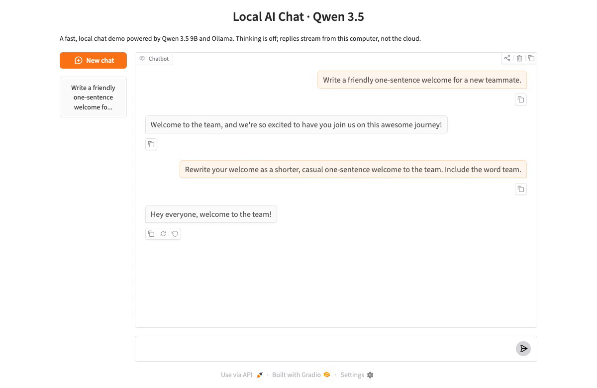

# Local AI Chat · Ollama

A local, streaming chatbot built with **Gradio** and **Ollama**. It uses
`qwen3.5:9b` with thinking disabled for direct chat responses, rather than
the slower reasoning-focused `deepseek-r1:7b` model. The model runs on the
computer hosting the app; nothing is sent to an external inference API,
and browser visitors do not download model weights.

## Demo

[](demo.mp4)

[Watch the 24-second demo video (MP4)](demo.mp4) · Two typed prompts show
streaming replies and a follow-up rewrite. The recording includes only the
chatbot browser viewport; no desktop or terminal is shown.

## Quick start

1. Install [Ollama](https://ollama.com/) and start its desktop app (or run
   `ollama serve`). Check for the model with `ollama list`; if needed, run
   `ollama pull qwen3.5:9b` once.
2. Use Python 3.11 or 3.12:

   ```bash
   python3.11 -m venv .venv
   source .venv/bin/activate
   python -m pip install -r requirements.txt
   python app.py
   ```

Open http://127.0.0.1:7860 if your browser doesn't open automatically.
The first response can take longer while Ollama loads the model into memory.
On the development machine, one short cold-start prompt took about **8 seconds**,
including about **6 seconds** of model loading; that is a single observation,
not a general performance benchmark. Press **Ctrl+C** to stop the app.

## How it works

`app.py` contains the Gradio UI. `ollama_chat.py` builds a bounded, text-only
conversation and streams responses from Ollama's local `/api/chat` endpoint.
It sets `think: false`, limits context to 4,096 tokens and output to 350
tokens, and reports common connection/model errors in the chat. The UI binds
only to `127.0.0.1`, so it isn't publicly accessible. No API key is needed.

The app keeps the latest 12 history messages and caps each message at 4,000
characters. Browser chat history is saved locally by Gradio. This is a
single-user demo, not an authenticated or production-ready service. Answers
can be incorrect; the app has no browsing, retrieval, or external tools.

## Tests and checks

Unit tests mock Ollama's HTTP responses—**Ollama and model weights are not
needed** to run them. They cover history filtering and size limits, request
settings, cumulative streaming, empty/malformed responses, connection errors,
and missing models.

```bash
python -m pip install -r requirements-dev.txt
python -m unittest discover -s tests -v
ruff check .
ruff format --check .
```

GitHub Actions runs these checks on Python 3.11 and 3.12, and verifies the
Gradio UI imports. For a live check, run the app and try one of its example
prompts. CI does not judge model answer quality or benchmark speed.

## Recording the demo

Start Ollama and the app before recording, then send a short warm-up message
so the model is loaded. Show a follow-up question to demonstrate conversation
history and the streamed response. Keep the terminal out of frame if it
contains personal paths or information.
